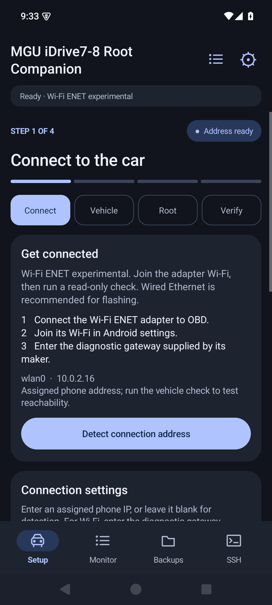
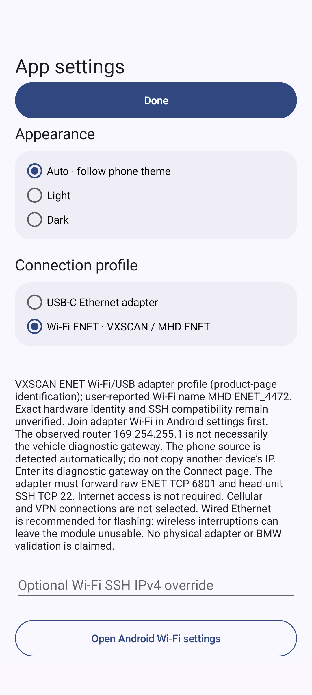

# MGU iDrive7-8 Root Companion

An experimental, self-contained **Android version of [idrive7-8-ssh-root](https://github.com/cauliflowermossgrape/idrive7-8-ssh-root)** for BMW MGU iDrive 7/8 head units over USB Ethernet or experimental Wi-Fi ENET.

**v0.7.0 pre-release**

## Full credits

**Full credit for the original rooting work, research, diagnostic/flashing workflow and supplied assets goes to [cauliflowermossgrape](https://github.com/cauliflowermossgrape) and the [original project](https://github.com/cauliflowermossgrape/idrive7-8-ssh-root).**

This project is an Android adaptation of the author's work, adding a phone interface and bundled runtime. It does not claim the original rooting method as its own. The pinned upstream source is preserved in [`vendor/upstream`](vendor/upstream), together with its original license.

## Features

- **Setup:** guided connection, VIN/compatibility checks, root setup and verification.
- **Monitor:** live status, logs, issue filtering and log export.
- **Backups:** private key/data export and read-only coding dumps.
- **SSH:** repair, persistence and access-management controls.
- **Settings:** Light, Dark or Auto appearance; separate USB/Wi-Fi connection profiles.
- **Wi-Fi ENET (experimental):** VXSCAN ENET Wi-Fi/USB profile, including the user-reported MHD ENET_4472 address range; selected-network routing and optional SSH override.
- Runs entirely on the phone: **no PC or Termux required at runtime**.

 

## Requirements

- Android 8.0 or newer; USB-C Ethernet + ENET cable, or a Wi-Fi ENET adapter that forwards raw diagnostic TCP 6801 and head-unit SSH TCP 22.
- A correctly assigned address and route for the selected connection.
- An authorized, parked vehicle and stable phone/vehicle power.

**Phone root is optional.** Some phones can configure Ethernet through Android settings; others may need the optional rooted network helper.

## Install

1. Download the APK from this repository's **Releases** page and install it.
2. Open the gear icon to choose Light, Dark or Auto and USB Ethernet or Wi-Fi ENET. Join adapter Wi-Fi in Android settings, enter its diagnostic gateway on Connect, then select the actual head-unit variant.
3. Run **Check compatibility & read VIN** first and verify the VIN physically.
4. Read the warnings and verify a restorable coding backup before considering any flash.

See [adapter setup and identity limitations](docs/WIFI-ADAPTER.md). Standard USB-C Ethernet support remains available. The app icon now includes BMW MGU text.

## Wi-Fi ENET limitations

Wi-Fi support is experimental and adapter-dependent. Join the adapter SSID manually and stay connected if Android reports no internet. The app binds to the selected Wi-Fi network and source address; it does not select cellular or VPN routes. Private IPv4 and usable IPv4 link-local endpoints are allowed. Configure an optional SSH IPv4 override in Settings if required by the adapter. Bluetooth, proprietary app-only protocols, arbitrary port remapping and automatic SSID discovery are not supported.

**Prefer wired Ethernet for flashing.** A Wi-Fi dropout can interrupt programming and leave the head unit unusable. A successful VIN/compatibility check verifies diagnostics, not that a closed SSH port will become reachable after flashing. No physical Wi-Fi adapter has been validated.

## Important warnings

**Flashing can permanently damage the head unit, erase coding/CAFD and delete Digital Key pairings.** A diagnostic dump is not a guaranteed coding-tool backup. Never repeat flashing merely to fix reset settings.

The upstream default root SSH key is shared. Protect exported keys and keep the diagnostic network isolated.

**Experimental: build and emulator checks passed, but this app has not been tested on a physical Android phone or real BMW head unit.** Compatibility and safe operation are not guaranteed. See [`VALIDATION.md`](VALIDATION.md).

## Build and documentation

Build requirements: JDK 17, Python 3.13 and Android SDK 35. From `android/` run `./gradlew assembleDebug lint` (`gradlew.bat` on Windows).

See the [detailed setup/build guide](docs/BUILD-AND-USAGE.md), [design notes](DESIGN.md), [license](LICENSE) and [third-party notices](THIRD-PARTY.md). This project is not affiliated with BMW.
