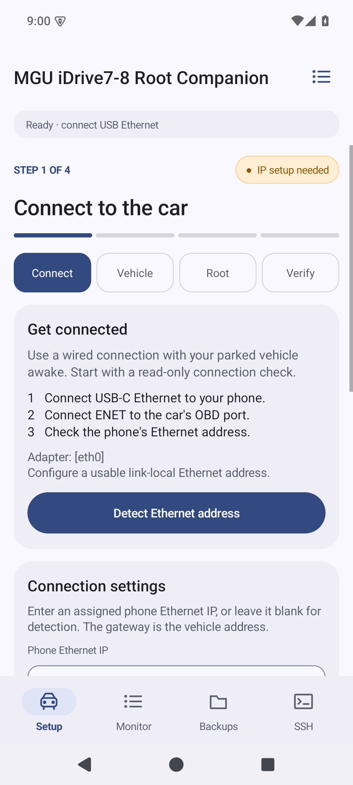

# MGU iDrive7-8 Root Companion

An experimental, self-contained **Android version of [idrive7-8-ssh-root](https://github.com/cauliflowermossgrape/idrive7-8-ssh-root)** for BMW MGU iDrive 7/8 head units over wired ENET.

## Full credits

**Full credit for the original rooting work, research, diagnostic/flashing workflow and supplied assets goes to [cauliflowermossgrape](https://github.com/cauliflowermossgrape) and the [original project](https://github.com/cauliflowermossgrape/idrive7-8-ssh-root).**

This project is an Android adaptation of the author's work, adding a phone interface and bundled runtime. It does not claim the original rooting method as its own. The pinned upstream source is preserved in [`vendor/upstream`](vendor/upstream), together with its original license.

## Features

- **Setup:** guided connection, VIN/compatibility checks, root setup and verification.
- **Monitor:** live status, logs, issue filtering and log export.
- **Backups:** private key/data export and read-only coding dumps.
- **SSH:** repair, persistence and access-management controls.
- Runs entirely on the phone: **no PC or Termux required at runtime**.

## Requirements

- Android 8.0 or newer; a supported USB-C Ethernet adapter and wired ENET cable.
- A correctly assigned/routed Ethernet address on the vehicle's link-local network.
- An authorized, parked vehicle and stable phone/vehicle power.

**Phone root is optional.** Some phones can configure Ethernet through Android settings; others may need the optional rooted network helper.

## Install

1. Download the APK from this repository's **Releases** page and install it.
2. Open the app, connect Ethernet/ENET, and select the actual head-unit variant.
3. Run **Check compatibility & read VIN** first and verify the VIN physically.
4. Read the warnings and verify a restorable coding backup before considering any flash.

## Important warnings

**Flashing can permanently damage the head unit, erase coding/CAFD and delete Digital Key pairings.** A diagnostic dump is not a guaranteed coding-tool backup. Never repeat flashing merely to fix reset settings.

The upstream default root SSH key is shared. Protect exported keys and keep the diagnostic network isolated.

**Experimental: build and emulator checks passed, but this app has not been tested on a physical Android phone or real BMW head unit.** Compatibility and safe operation are not guaranteed. See [`VALIDATION.md`](VALIDATION.md).

## Build and documentation

Build requirements: JDK 17, Python 3.13 and Android SDK 35. From `android/` run `./gradlew assembleDebug lint` (`gradlew.bat` on Windows).

See the [detailed setup/build guide](docs/BUILD-AND-USAGE.md), [design notes](DESIGN.md), [license](LICENSE) and [third-party notices](THIRD-PARTY.md). This project is not affiliated with BMW.
